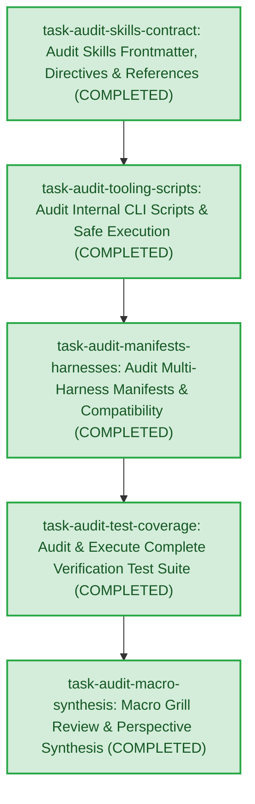

# Macro Perspective Document: Agent Skills Toolkit Comprehensive Review

## 1. High-Level Objective
Telescope dual-lens audit across 6 skills, CLI scripts, multi-harness manifests, test matrices, and zero-defect compliance

**Completion**: 5/5 tasks completed (0 micro-grilled, 100% ready)

## 2. Visual Architecture & Dependency DAG

## 3. Low-Level Task Execution Graph
| ID | Title | Dependencies | Status | Notes |
|---|---|---|---|---|
| `task-audit-skills-contract` | Audit Skills Frontmatter, Directives & References | None | `COMPLETED` | Passed YAML frontmatter validation and 100% of relative progressive disclosure links verified |
| `task-audit-tooling-scripts` | Audit Internal CLI Scripts & Safe Execution | task-audit-skills-contract | `COMPLETED` | Zero dynamic eval vulnerabilities across 9 CLI scripts; all return exit code 0 on --help |
| `task-audit-manifests-harnesses` | Audit Multi-Harness Manifests & Compatibility | task-audit-tooling-scripts | `COMPLETED` | Live verified Antigravity LS, Claude plugin/marketplace manifests, OpenCode API indexing, and Node bin runner |
| `task-audit-test-coverage` | Audit & Execute Complete Verification Test Suite | task-audit-manifests-harnesses | `COMPLETED` | 100% of unit and scenario tests passed (49/49) across skill-creator, telescope, deep-tester, and installer |
| `task-audit-macro-synthesis` | Macro Grill Review & Perspective Synthesis | task-audit-test-coverage | `COMPLETED` | Full 9-persona macro architecture certified; rendered living PERSPECTIVE.md |
