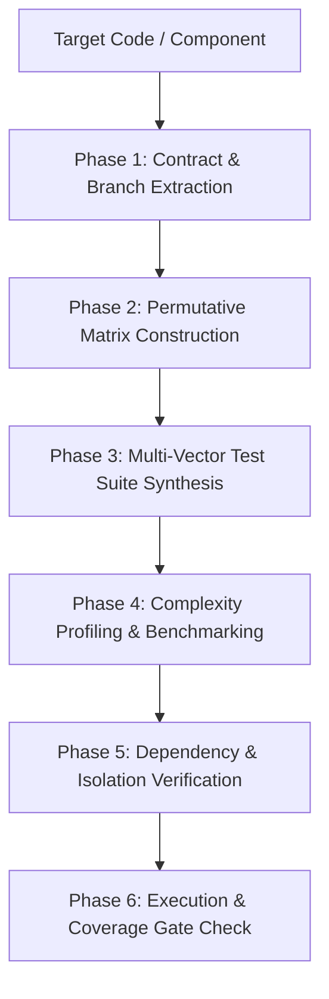

# Deep-Tester: Universal Multi-Vector Test Engineering Protocol

The **Deep-Tester** skill establishes language-agnostic, zero-defect test engineering across functional boundaries, combinatorial parameter matrices, security vectors, memory/CPU profiling, and asymptotic complexity verification.

---

## 1. Trigger Conditions

The agent MUST activate this skill when:
1. Writing new tests, generating test suites, or adding test coverage for code in any programming language (Python, TypeScript, Go, Rust, Java, C++).
2. The user types `/test`, *"write tests for X"*, *"generate test matrix"*, or *"benchmark performance"*.
3. Completing code generation under `single-pass-executor` or `telescope`.

---

## 2. 6-Phase Test Engineering Workflow



### Phase 1: Contract & Branch Extraction
- MUST extract all input types, ranges, boundary conditions ($0, 1, \infty, \text{None}$), and declared exceptions.
- MUST identify all conditional branches (`if-else`, `match`, loop guards) to target $\ge 90\%$ branch coverage.

### Phase 2: Permutative Matrix Construction
When code accepts multi-state parameters:
1. Run the matrix generator CLI to produce a Cartesian product or Pairwise covering array:
   ```bash
   python3 ~/.gemini/config/skills/deep-tester/scripts/matrix_generator.py \
     '{"role": ["admin", "user", "guest"], "status": ["active", "suspended"]}' \
     --format pytest \
     --filter "role == 'guest' and status == 'admin'"
   ```
2. Formats supported: `pytest` (Python), `jest` (TS/JS), `go` (Go), `rust` (Rust), `junit` (Java), `markdown`, and `json`.

### Phase 3: Multi-Vector Test Suite Synthesis
The synthesized test suite MUST implement the 5 required vectors:
- **Vector A (Functional)**: Positive happy path + negative edge cases ($0$, $1$, $\text{NaN}$, empty string, embedded `\x00`). Floating point assertions MUST use approximate equality helpers (`pytest.approx`, `toBeCloseTo`, `math.Abs`).
- **Vector B (Security)**: SQL/Command injection payloads, path traversal (`../../`), constant-time signature equality (`hmac.compare_digest`, `subtle.ConstantTimeCompare`).
- **Vector C (Resources)**: Memory allocation checks (`tracemalloc`, `process.memoryUsage()`, `runtime.MemStats`), recursion depth limit guards.
- **Vector D (Performance)**: Asymptotic scaling assertions ($T(10N)/T(N) < 20.0$), latency p95 percentiles, native benchmark harnesses.
- **Vector E (Dependencies)**: Mock external APIs with ephemeral port 0 allocation and fault injection (HTTP 429/500/503).
- Standards reference: [test-matrix-taxonomy.md](./references/test-matrix-taxonomy.md).

### Phase 4: Complexity Profiling & Reduction
- When asymptotic tests indicate super-linear scaling on expected $O(N)$ operations:
  - Run language-native profiler (`cProfile`, `pprof`, `dhat`, V8 profiler) to locate hot spot functions.
  - Apply complexity reduction prescriptions (e.g. hash sets replacing linear scans).
  - Reference guidelines: [complexity-benchmarking.md](./references/complexity-benchmarking.md).

### Phase 5: Dependency Isolation & Safety
- Unit tests MUST NOT perform real network requests.
- Mock servers MUST bind to ephemeral port `0` (`sock.bind(('127.0.0.1', 0))`).
- ReDoS watchdog timeouts MUST cap regex execution at $500\text{ms}$.

### Phase 6: Execution & Coverage Gate Check
- MUST execute tests via native runner (`pytest`, `npm test`, `go test -v -cover`, `cargo test`, `mvn test`).
- MUST verify that tests execute with zero failures and achieve target branch coverage before completion.
- Reference exemplar: [comprehensive-test-suite.md](./examples/comprehensive-test-suite.md).
