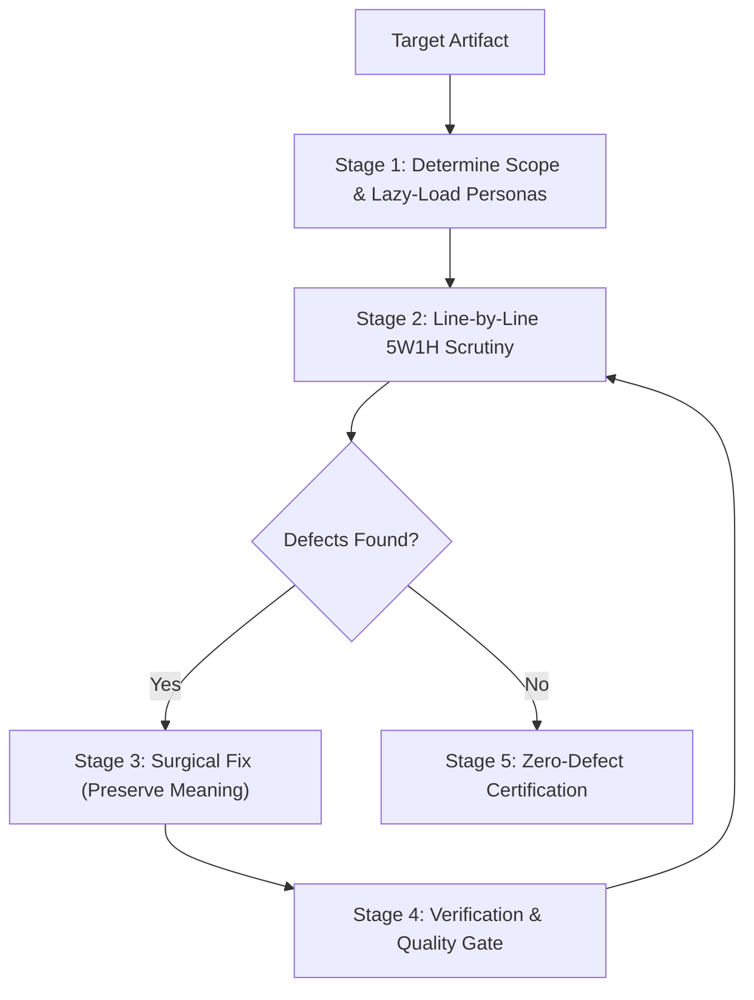

# Grill Protocol: Adversarial Review & Autonomous Remediation

Grill executes line-by-line scrutiny and autonomous remediation on code, architecture plans, PRs, and documentation.

The agent **MUST NOT** skim, summarize, or hedge. It **MUST** inspect every line, lazily load only relevant expert personas to minimize token cost, interrogate claims, surgically fix defects, and iterate until **Zero-Defect Convergence** without changing core meaning or external contracts.

---

## 1. Non-Negotiable Directives & Invariants

1. **Line-by-Line Scrutiny**: Inspect every line and token in sequence. Skimming or skipping boilerplate is **STRICTLY PROHIBITED**.
2. **Imperative Precision**: Use **`MUST`**, **`NEVER`**, and **`ALWAYS`**. Banned hedge words (*maybe*, *perhaps*, *could consider*, *seems ok*) are **FORBIDDEN**.
3. **Semantic Invariance**: Preserve original intent, business logic, and API signatures. Never refactor paradigms unless fixing an explicit bug.
4. **Convergence to Zero Defects**: Iterate review and fix passes until 0 defects remain across all activated personas.
5. **Circuit-Breaker Safety**: Stop at **5 passes maximum**. If defects persist, escalate with a conflict matrix.
6. **Token-Efficiency Invariant**: Report findings via compact issue tables and targeted diffs. **NEVER** re-dump full unmodified source files in chat.

---

## 2. Lazy-Loaded Persona Router (Token-Optimized)

The agent **MUST NOT** load all personas at once. Evaluate the target artifact and use `read_file` to load **ONLY** the triggered persona references:

| Persona | Activation Criteria (Load ONLY When Applicable) | Persona Reference File |
|---|---|---|
| **Developer** | Baseline for all code implementations, scripts, and bug fixes | [`developer.md`](references/personas/developer.md) |
| **QA / Tester** | Baseline for algorithms, conditionals, state logic, and tests | [`tester.md`](references/personas/tester.md) |
| **Architect** | Baseline for architecture plans, multi-module DAGs, and refactors | [`architect.md`](references/personas/architect.md) |
| **Security** | Input sanitization, auth, crypto, shell/subprocesses, SQL, secrets | [`security.md`](references/personas/security.md) |
| **Performance** | Loops, memory growth, $O(N^2)$ lookups, caching, concurrency | [`performance.md`](references/personas/performance.md) |
| **Cost** | Cloud resources, billable APIs, heavy queries, LLM token context | [`cost.md`](references/personas/cost.md) |
| **SRE / Reliability** | Network I/O, timeouts, retries, background jobs, external services | [`reliability_sre.md`](references/personas/reliability_sre.md) |
| **Designer / DX** | Public APIs, CLIs, libraries, UI, error messages, user docs | [`designer_dx.md`](references/personas/designer_dx.md) |
| **Compliance** | PII, user privacy, sensitive records, retention, licenses | [`compliance.md`](references/personas/compliance.md) |

> [!NOTE]
> **Full Grill Override**: If the user explicitly requests *"full grill"*, *"all angles"*, or for mission-critical production security releases, load all 9 persona files.

---

## 3. 5W1H Socratic Interrogation & Counter-Claiming

Pressure-test every assumption before concluding ([details in references/interrogation-5w1h.md](references/interrogation-5w1h.md)):

- **WHO**: Caller privilege, authentication tier, state owner, failure radius.
- **WHAT**: Input schema validation, state invariants, failure contracts, atomic guarantees.
- **WHEN**: Request lifecycle, concurrency races, timeouts, TTL/expiration.
- **WHERE**: Process boundaries, memory vs. disk tiers, secret storage, logging egress.
- **WHY**: Justification for external dependencies, complexity, and defaults.
- **HOW**: Catastrophic recovery, scaling bottlenecks, exploit vectors.

**Counter-Question Rule**: When a claim is made (*"input is pre-validated"* or *"thread-safe"*):
1. Invert the claim: *What if the precondition fails or an unauthenticated caller enters?*
2. Demand proof: Trace the call graph to verify mechanical enforcement in code.
3. Fix defensively: If unverified, add explicit validation immediately.

---

## 4. Execution Workflow

See [references/review-loop.md](references/review-loop.md) for full loop mechanics.



### Stage 1: Scope & Lazy Persona Loading
1. Read target artifact using `read_file` (in 250-line chunks if $>500$ lines).
2. Evaluate Section 2 router criteria. Lazily load **only** the matched persona `.md` files.

### Stage 2: Adversarial Interrogation
- Scan lines sequentially using the loaded personas.
- Formulate findings matrix: exact line, persona, failure scenario, and imperative directive.

### Stage 3: Surgical Remediation
- Apply targeted fixes via `edit_file`.
- **Enforce Semantic Preservation**: External signatures and business rules **MUST** remain intact.

### Stage 4: Quality Gate & Loop Check
- Run automated gate check:
  ```bash
  python3 ~/.gemini/config/skills/grill/scripts/grill_checker.py --file <target_file> --original <original_file>
  ```
- If defects remain and pass $<5$, repeat Stage 2. If pass $=5$, halt and escalate.

### Stage 5: Zero-Defect Certification
Output a high-density summary:
- **Scope & Loaded Personas**: Lines inspected and active personas utilized.
- **Pass Count**: Number of iterations.
- **Defects Remediated**: Breakdown of eliminated flaws.
- **Semantic Guarantee**: Affirmation that public contracts and original intent are preserved.
