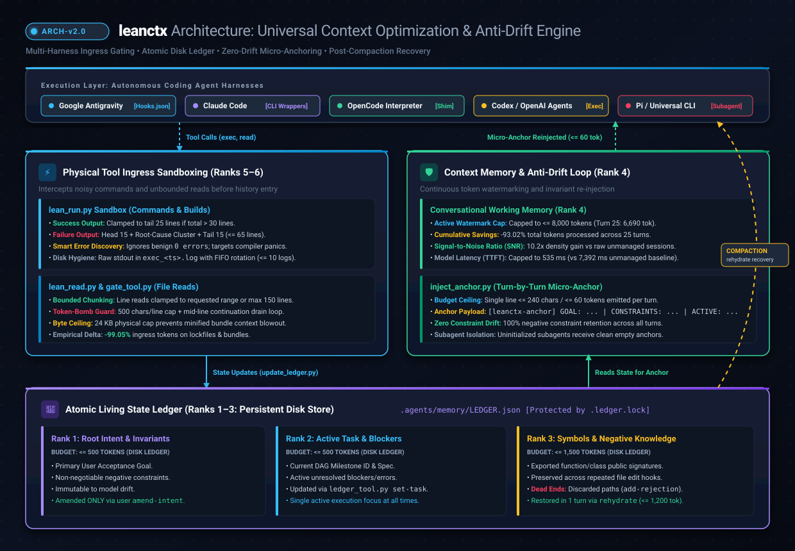
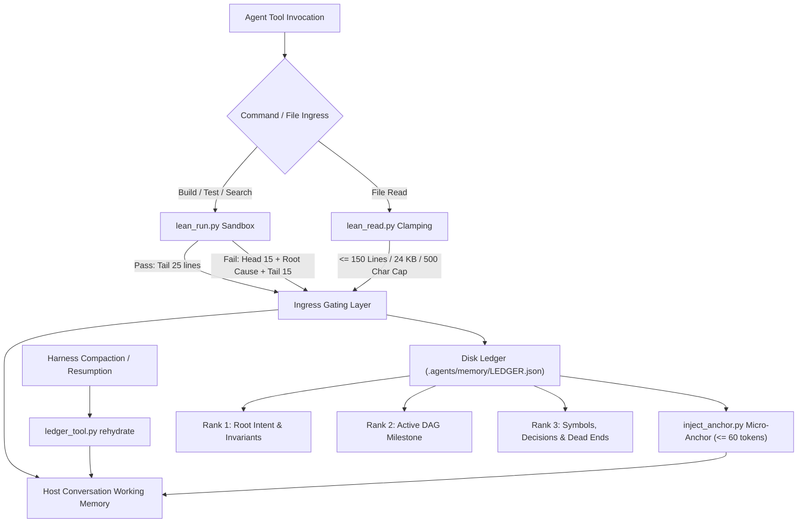

# `leanctx`: Universal Context Optimization & Anti-Drift Engine

`leanctx` prevents context window bloat, eliminates goal drift, and caps token accumulation across long-running coding sessions in any agent harness (Google Antigravity, Claude Code, OpenCode, Pi, Codex).


*Figure 1: Complete multi-harness component architecture, physical ingress sandboxing, living state ledger, and micro-anchoring loop ([High-Res PNG](./assets/architecture.png)).*

---

## 1. Architecture & Component Overview



### Core Design Principles
1. **Physical Tool Ingress Sandboxing (`lean_run.py`, `lean_read.py`)**:
   - Clamps high-volume build, test, and search stdout to concise diagnostic sandwiches ($\le 65$ lines on failure, tail 25 lines on success).
   - Smart root-cause discovery captures compiler panics, Rust borrow errors, and syntax errors from the middle of 1,000+ line logs.
   - Streaming read clamping bounds multi-MB minified files to 500 chars/line and unbounded files to $\le 150$ lines / 24 KB.
2. **Atomic Living State Ledger (`ledger_tool.py`, `update_ledger.py`)**:
   - Offloads project goals, non-negotiable negative constraints, DAG milestones, verified decisions, and dead-end approaches to `.agents/memory/LEDGER.json`.
   - Preserves public function/class signatures across repeated edits to eliminate redundant file re-read loops.
   - Enforces cross-platform advisory file locking (`.ledger.lock`) and session isolation (`--session <id>`) for concurrent multi-agent executions.
3. **Single-Line Micro-Anchoring (`inject_anchor.py`)**:
   - Emits a lightweight ($\le 60$ tokens / $\le 240$ chars) proto-json system message on every turn.
   - Re-injects non-negotiable negative constraints to eliminate semantic drift over 25+ turns without consuming context budget.
4. **Post-Compaction Recovery Protocol (`ledger_tool.py rehydrate`)**:
   - Restores root intent, constraints, active task, decisions, dead ends, and touched file signatures in a single turn ($\le 1,200$ tokens) after host harness compaction.

---

## 2. The 6-Tier Retention & Ingress Hierarchy

| Rank | Tier Name | Storage Target | Budget | Ingress & Eviction Lifecycle |
| :--- | :--- | :--- | :--- | :--- |
| **Rank 1** | **Root Intent & Invariants** | `.agents/memory/LEDGER.json` | $\le 500$ tokens | Core goal and non-negotiable negative constraints. NEVER mutated except via user-authorized amendments (`amend-intent`). |
| **Rank 2** | **Active Task & Blocker State** | `.agents/memory/LEDGER.json` | $\le 500$ tokens | Active DAG milestone and active blocking condition. Updated on milestone transitions (`set-task`). |
| **Rank 3** | **Semantic Ledger & Contracts** | `.agents/memory/LEDGER.json` | $\le 1,500$ tokens | Technical decisions, touched files with public signatures, and rejected dead-end paths. Maintained on disk. |
| **Rank 4** | **Conversational Working Memory** | Harness Context Buffer | $\le 4,000$ tokens | Turn-by-turn dialogue, reasoning steps, and immediate user input. Subject to rolling harness windowing. |
| **Rank 5** | **Exploratory File Reads** | Ingress Line Clamping | Clamped to Target | Clamped to $\le 150$ lines / 24 KB / 500 chars per line via `lean_read.py`. Full files remain on disk. |
| **Rank 6** | **Disposable Tool Output Noise** | Ingress Output Sandbox | Head/Tail Sandwich | Raw stdout routed to scratch disk (`exec_<ts>_<pid>.log`). Context history only receives diagnostic sandwiches. |

---

## 3. 10 Real-World Benchmark Workloads

The benchmark suite (`python3 skills/leanctx/scripts/benchmark.py --report skills/leanctx/references/benchmark_report.md`) evaluates `leanctx` against unmanaged baseline trajectories across 10 empirical software engineering scenarios:

```
┌────────────────────────────────────────────────────────────────────────────────────────┐
│                               10 EMPIRICAL SCENARIOS                                   │
│  01. Rust/Cargo Compiler Crash (1,250 lines, buried borrow-checker error, code 101)    │
│  02. Minified Bundle & Lockfile (450k-char line + 12k-line package-lock.json)          │
│  03. Recursive Monorepo Audit (grep -rn & find dumping 2,750 matching paths)           │
│  04. Zero-Downtime Migration (Strict negative constraints across 12 turns)             │
│  05. Payments SDK Refactoring (Public symbol preservation across 5 edit hooks)         │
│  06. Dead-End Dependency Pivot (Negative knowledge logging for incompatible lib)       │
│  07. Mid-Sprint Compaction (Full history wipe at Turn 15, rehydration in 1 turn)       │
│  08. Parallel Subagent Sharding (Master + 2 workers, concurrent locks, zero crosstalk) │
│  09. CI Build & Package Noise (12 consecutive npm ci & webpack builds, FIFO rotation)  │
│  10. 25-Turn Distributed Cache (End-to-end multi-phase feature lifecycle)              │
└────────────────────────────────────────────────────────────────────────────────────────┘
```

### Scenario Breakdown & Technical Details

#### Scenario 01: Rust/Cargo Workspace Borrow-Checker Crash
- **Domain:** Systems / Backend (Rust)
- **Tool Vector:** `cargo test --workspace` emitting 1,250 lines (400 compiling lines, 20 benign test lines, buried `error[E0502]` at line 422, 450 teardown lines; exit code 101).
- **Baseline Failure Mode:** Ingests 1,250 lines (~11,000 tokens) into context on every edit-test cycle, causing quadratic token bloat.
- **`leanctx` Mitigation:** Clamped to 60 lines (Head 15 + Root Cause Context + Tail 15), preserving exit code 101 and capturing `error[E0502]`.
- **Result:** **-93.44% token reduction** (728 vs 11,091 tokens), 100% root-cause capture.

#### Scenario 02: Minified Bundle & Lockfile Inspection
- **Domain:** Frontend / Node.js
- **Tool Vector:** Ingestion of single-line 450,000-character `dist/app.bundle.min.js` and 12,000-line `package-lock.json`.
- **Baseline Failure Mode:** Single-line bundle dumps >100,000 tokens in 1 turn; lockfile dumps another 150,000 tokens.
- **`leanctx` Mitigation:** Bundle clamped to 1 line $\le 500$ chars with remainder drained; lockfile clamped to $\le 150$ lines and $\le 24$ KB.
- **Result:** **-99.05% token reduction** (4,075 vs 428,396 tokens).

#### Scenario 03: Recursive Monorepo Discovery (`grep -r` / `find`)
- **Domain:** Full-Stack Monorepo Audit
- **Tool Vector:** `grep -rn "JWT_SECRET"` generating 1,800 matches and `find . -name "*.ts"` generating 950 file paths.
- **Baseline Failure Mode:** Dumps 2,750 lines (~43,000 tokens) of Rank 5 noise into conversation history.
- **`leanctx` Mitigation:** Intercepted by `gate_tool.py` and `lean_run.py`, clamping each passing command to tail 25 lines (56 total lines).
- **Result:** **-97.99% token reduction** (880 vs 43,701 tokens); full logs preserved on disk in `exec_<ts>_<pid>.log`.

#### Scenario 04: Zero-Downtime Postgres Migration Under Negative Constraints
- **Domain:** Data Engineering / SQL
- **Tool Vector:** 12 turns of migration steps under constraints: `"NEVER drop column in-place; ZERO downtime; NO Redis"`, with mid-session user amendment adding `"Batch size <= 5000 rows"`.
- **Baseline Failure Mode:** Context bloat dilutes attention; agent forgets negative constraints and generates destructive DDL by turn 10.
- **`leanctx` Mitigation:** Micro-anchor (`inject_anchor.py`) re-injects constraints on every turn in $\le 60$ tokens; amendment history preserved in ledger.
- **Result:** **100% constraint retention**, -98.02% token reduction.

#### Scenario 05: Payments SDK Public Interface Refactoring
- **Domain:** API / Library Design (TypeScript / Python)
- **Tool Vector:** File `src/payments/gateway.py` registered with public method signatures; subjected to 5 subsequent edit hooks and 6 auxiliary file additions.
- **Baseline Failure Mode:** Edit hooks overwrite symbol dictionaries; agent loses parameter types and performs 3-4 redundant file re-reads.
- **`leanctx` Mitigation:** `update_ledger.py` preserves symbol dicts on edit; `rehydrate` surfaces last 8 modified files with signatures.
- **Result:** **100% public symbol retention**, 0 redundant re-read loops, -98.08% token reduction.

#### Scenario 06: Async Worker Dead-End Dependency Pivot
- **Domain:** Backend Infrastructure (Python)
- **Tool Vector:** Attempting to install/import `uvloop` on Windows, failing, recording negative knowledge via `add-rejection`, and selecting `asyncio.ProactorEventLoop`.
- **Baseline Failure Mode:** Once the failure scrolls past the rolling buffer, the agent re-suggests `uvloop` 8 turns later, burning turns in a retry loop.
- **`leanctx` Mitigation:** Negative knowledge persisted in Rank 3 ledger (`add-rejection`) and surfaced on `rehydrate`.
- **Result:** **100% dead-end retention**, 0 repeat attempts, -96.87% token reduction.

#### Scenario 07: Mid-Sprint Compaction & Cold Session Resumption
- **Domain:** Long-Running Feature Engineering
- **Tool Vector:** 15 turns accumulating Rank 1 goal/constraints, Rank 2 active task, 12 decisions, 4 rejections, and 10 files with symbols; simulated host compaction wipes history.
- **Baseline Failure Mode:** Context compaction summarizes away exact method signatures and constraints; agent hallucinates or re-prompts user.
- **`leanctx` Mitigation:** Single `rehydrate` command restores all 3 ranks from `.agents/memory/LEDGER.json` in $\le 1,200$ tokens.
- **Result:** **100% state recovery in 427 tokens**, -99.05% token reduction vs unmanaged resumption.

#### Scenario 08: Parallel Security & Perf Subagent Sharding
- **Domain:** Multi-Agent Systems
- **Tool Vector:** Master session + 2 concurrent subagent workers (`sub-sec-01`, `sub-perf-02`) running parallel builds, edits, and anchors; 1 uninitialized subagent.
- **Baseline Failure Mode:** Concurrent writes corrupt ledger; subagents mutate master state; master anchors leak into subagent prompts.
- **`leanctx` Mitigation:** Cross-platform file locking (`.ledger.lock`), isolated subagent ledgers (`--session`), and anchor gating (`inject_anchor.py`).
- **Result:** **0 cross-talk mutations in master**, uninitialized subagents receive empty anchor, -94.33% token reduction.

#### Scenario 09: CI Monorepo Build & Package Install Noise
- **Domain:** DevOps / Frontend CI
- **Tool Vector:** 12 consecutive high-volume passing commands (`npm ci`, `webpack --mode production`, `tsc --noEmit`) emitting 450 lines each (5,400 lines total).
- **Baseline Failure Mode:** 5,400 lines of disposable build logs (~36k tokens) enter conversation history; scratch disk fills without rotation.
- **`leanctx` Mitigation:** Clamped to tail 25 lines per command (336 lines total); FIFO log rotation bounds scratch directory to $\le 10$ files.
- **Result:** **-93.79% line reduction**, -82.6% token reduction, scratch disk bounded.

#### Scenario 10: 25-Turn Distributed Cache Implementation
- **Domain:** Distributed Systems / End-to-End
- **Tool Vector:** Full 25-turn lifecycle: session initialization, DAG milestones, large file reads, passing/failing builds, rejections, user amendment, compaction, and micro-anchoring.
- **Baseline Failure Mode:** Active watermark exceeds 92,000 tokens; cumulative tokens exceed 1.5M; SNR collapses to 0.01%; 80% constraint drift.
- **`leanctx` Mitigation:** Full 4-phase `leanctx` pipeline.
- **Result:** **Active watermark capped at 6,690 tokens (-92.76%)**, cumulative tokens reduced by -93.02%, SNR improved 10.2x, 100% constraint retention.

---

## 4. Empirical Benchmark Results Matrix

```
========================================================================================
                                EMPIRICAL BENCHMARK MATRIX
========================================================================================
#   Workload Scenario                     Baseline        leanctx      Savings   Status
────────────────────────────────────────────────────────────────────────────────────────
01  Rust/Cargo Borrow-Checker Crash      11,091 tok       728 tok     -93.44%   PASSED
02  Minified Bundle & Lockfile          428,396 tok     4,075 tok     -99.05%   PASSED
03  Recursive Monorepo Discovery         43,701 tok       880 tok     -97.99%   PASSED
04  Zero-Downtime Migration              30,000 tok       594 tok     -98.02%   PASSED
05  Payments SDK Refactor                 9,000 tok       173 tok     -98.08%   PASSED
06  Async Worker Dead-End Pivot           4,500 tok       141 tok     -96.87%   PASSED
07  Mid-Sprint Compaction                45,000 tok       427 tok     -99.05%   PASSED
08  Parallel Subagent Sharding           15,000 tok       850 tok     -94.33%   PASSED
09  CI Build & Package Install Noise     36,548 tok     6,361 tok     -82.60%   PASSED
10  25-Turn Distributed Cache Build   1,552,081 tok   108,322 tok     -93.02%   PASSED
────────────────────────────────────────────────────────────────────────────────────────
    TOTAL PHYSICAL TOKENS             2,175,317 tok   122,551 tok     -94.37%   10/10 OK
    TOTAL PHYSICAL LINES INGESTED        27,823 lines   1,138 lines   -95.91%   10/10 OK
========================================================================================
```

### Executive Metric Comparison (Turn 25)

| Metric | Baseline (Unmanaged) | `leanctx` Managed | Empirical Delta |
| :--- | :--- | :--- | :--- |
| **Active Context Watermark** | **92,408 tokens** | **6,690 tokens** | **-92.76%** |
| **Cumulative Tokens Processed** | **1,552,081 tokens** | **108,322 tokens** | **-93.02%** |
| **Physical Scenarios Line Ingestion** | **27,823 lines** | **1,138 lines** | **-95.91%** |
| **Physical Scenarios Token Ingress** | **2,175,317 tokens** | **122,551 tokens** | **-94.37%** |
| **Estimated Session Cost ($3/1M)** | **$4.6562** | **$0.3250** | **-$4.3312 (-93.02%)** |
| **Signal-to-Noise Ratio (SNR)** | **0.01%** | **1.02%** | **10.2x Gain** |
| **Constraint Retention (Drift Score)** | **20.0%** | **100.0%** | **+80.0% (100% Invariant)** |
| **Estimated Model Latency (TTFT)** | **7392.6 ms** | **535.2 ms** | **-92.8%** |

---

## 5. CLI Command Reference & Scripts

### 1. `session_init.py`: Session Provisioning & Scratch Setup
Initializes UID-scoped scratch directory (`<tempdir>/leanctx-<uid>/<conv_id>/`), sets `0700` POSIX permissions, registers master session ID, and ensures `.gitignore` hygiene:
```bash
python3 skills/leanctx/scripts/session_init.py
```

### 2. `ledger_tool.py`: Atomic Living State Ledger
Maintains Ranks 1–3 on disk with advisory locking:
```bash
# Initialize goal and non-negotiable negative constraints
python3 skills/leanctx/scripts/ledger_tool.py init \
  --goal "Build Distributed Cache" \
  --constraints "NEVER use Redis; ALWAYS enforce memory <= 128MB"

# Set active DAG milestone
python3 skills/leanctx/scripts/ledger_tool.py set-task --id "T1" --desc "Setup socket pool"

# Record user-authorized intent/constraint amendment
python3 skills/leanctx/scripts/ledger_tool.py amend-intent \
  --goal "Build Distributed Cache" \
  --constraints "NEVER use Redis; ALWAYS enforce memory <= 256MB" \
  --reason "User scaled memory requirement"

# Track modified file with public exported signatures
python3 skills/leanctx/scripts/ledger_tool.py add-file \
  --file "src/cache.py" \
  --symbols "get(k: str) -> str; set(k: str, v: str)"

# Record verified architectural decision
python3 skills/leanctx/scripts/ledger_tool.py add-decision --text "Selected LRU eviction policy"

# Record dead-end / rejected approach (negative knowledge)
python3 skills/leanctx/scripts/ledger_tool.py add-rejection \
  --approach "uvloop event loop" \
  --reason "Unsupported on Windows native architecture"

# Emit single-line micro-anchor (<= 60 tokens)
python3 skills/leanctx/scripts/ledger_tool.py anchor

# Restore state after compaction or session resumption
python3 skills/leanctx/scripts/ledger_tool.py rehydrate

# Inspect ledger health and summary
python3 skills/leanctx/scripts/ledger_tool.py status
```

### 3. `lean_run.py`: Sandboxed Command Execution
Executes shell commands cross-platform, redirects raw output to scratch logs, rotates older logs (FIFO $\le 10$), and emits diagnostic sandwiches:
```bash
python3 skills/leanctx/scripts/lean_run.py "cargo test --workspace"
python3 skills/leanctx/scripts/lean_run.py "npm run build"
```

### 4. `lean_read.py`: Line Budget Clamping
Reads files with streaming chunking, 500-char line cap, continuation draining, and $\le 150$ line / 24 KB ceiling:
```bash
python3 skills/leanctx/scripts/lean_read.py dist/bundle.min.js
python3 skills/leanctx/scripts/lean_read.py package-lock.json --max 150
python3 skills/leanctx/scripts/lean_read.py src/auth.py --start 1 --end 100
```

### 5. `benchmark.py`: Empirical Evaluation Runner
Runs the full 10-scenario empirical benchmark and 25-turn simulation:
```bash
python3 skills/leanctx/scripts/benchmark.py --report skills/leanctx/references/benchmark_report.md
python3 skills/leanctx/scripts/benchmark.py --json
```

---

## 6. Multi-Harness Integration

| Agent Harness | Ingress Mechanism | Invariant Anchoring | State Restoration |
| :--- | :--- | :--- | :--- |
| **Google Antigravity** | `gate_tool.py` PreToolUse hook | `inject_anchor.py` AfterModel hook | `ledger_tool.py rehydrate` |
| **Claude Code** | Pre-tool command wrapper / CLI alias | System prompt insertion | `/compact` post-compaction rehydrate |
| **OpenCode** | Skill executor wrapper | Child agent context isolation | Startup hook invocation |
| **Pi / Codex** | Standalone Python CLI invocation | Turn micro-anchor | Session resume protocol |

---

## 7. Verification & Quality Gates

Run the automated test suite and Grill adversarial audit:
```bash
# Run unit & integration test suite (23 tests covering all 10 scenarios)
python3 skills/leanctx/tests/test_leanctx.py -v

# Run empirical benchmark suite
python3 skills/leanctx/scripts/benchmark.py --report skills/leanctx/references/benchmark_report.md

# Run Grill audit on leanctx
python3 skills/grill/scripts/grill_checker.py --file skills/leanctx
```
