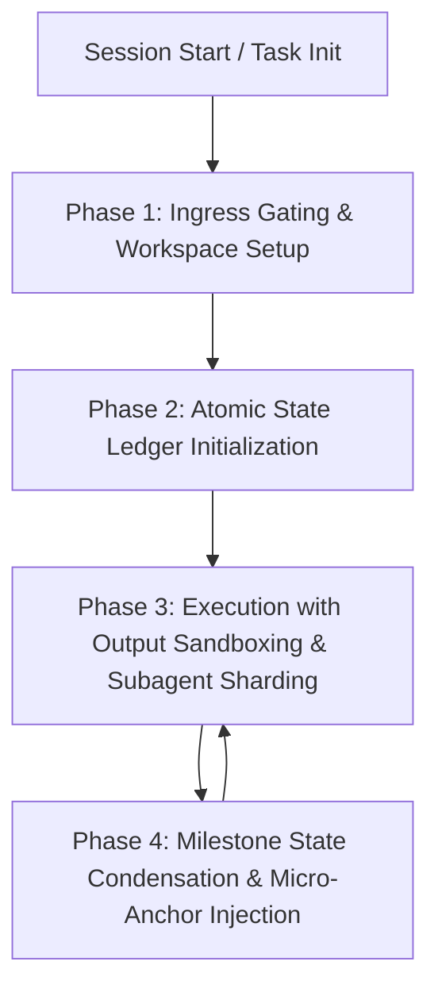

# leanctx: Universal Context Optimization & Anti-Drift Engine

`leanctx` prevents context window bloat, eliminates goal drift, and reduces quadratic token accumulation across long-running sessions in any coding agent harness (Google Antigravity, Claude Code, OpenCode, Pi, Codex).

---

## 1. Trigger Conditions

The agent MUST activate `leanctx` when:
1. The user demands long-running session optimization, context trimming, or token cost minimization.
2. A task involves running verbose builds, test suites, multi-file codebase explorations, or multi-phase refactoring.
3. A session exceeds 10 turns and risks attention degradation or goal drift.

---

## 2. The 6-Tier Context Retention Protocol

The agent MUST classify and govern all in-context data according to the retention hierarchy ([details in references/context-taxonomy.md](./references/context-taxonomy.md)):

```
┌────────────────────────────────────────────────────────┐
│ Rank 1: Root Intent & Invariant Rules   (ALWAYS KEEP)  │
│ Rank 2: Active Task & Blocker State    (KEEP UNTIL DONE)│
│ Rank 3: Semantic Ledger & Contracts    (CONDENSE & KEEP)│
├────────────────────────────────────────────────────────┤
│ Rank 4: Immediate Operational Buffer   (ROLLING 2 TURNS)│
│ Rank 5: Exploratory File Line Dumps    (EVICT ON READ)  │
│ Rank 6: Disposable Build / Test Noise  (ZERO RETENTION) │
└────────────────────────────────────────────────────────┘
```

- **Ranks 1–3**: Maintained persistently in `.agents/memory/LEDGER.json`.
- **Ranks 5–6**: Intercepted, truncated, or redirected to `/tmp/leanctx/<id>/`.

---

## 3. 4-Phase Operational Execution



### Phase 1: Ingress Gating & Workspace Setup
1. Verify scratch directory permissions (`0700` mode) and `.gitignore` hygiene:
   ```bash
   python3 skills/leanctx/scripts/session_init.py
   ```
2. In harnesses with hook support (Antigravity), verify `skills/leanctx/hooks.json` is loaded.

### Phase 2: Atomic State Ledger Initialization
1. Initialize the root intent and non-negotiable negative constraints:
   ```bash
   python3 skills/leanctx/scripts/ledger_tool.py init \
     --goal "<Primary User Acceptance Goal>" \
     --constraints "<Constraint 1>; <Constraint 2>"
   ```
2. Register active DAG milestone:
   ```bash
   python3 skills/leanctx/scripts/ledger_tool.py set-task \
     --id "<Task ID>" \
     --desc "<Task Objective>"
   ```

### Phase 3: Execution via Sandboxed Gating & Context Sharding
1. **High-Volume Command Execution**:
   - In Antigravity: `gate_tool.py` automatically wraps commands matching `(test|build|install|find|grep|log)`.
   - In Claude Code / OpenCode / Pi: The agent MUST execute high-volume commands via `lean_run.py`:
     ```bash
     python3 skills/leanctx/scripts/lean_run.py "<test_or_build_command>"
     ```
   - Succeeded commands emit tail 25 lines. Failed commands emit Head 25 + Tail 25 diagnostic sandwiches.
2. **File Reading Line Clamping**:
   - Never ingest entire multi-hundred line files without line bounds.
   - Use targeted ranges or invoke `lean_read.py`:
     ```bash
     python3 skills/leanctx/scripts/lean_read.py <path> --start 1 --end 120
     ```
3. **Subagent Context Sharding**:
   - For broad codebase scans or multi-step debugging, launch an isolated subagent (`invoke_subagent`).
   - The subagent absorbs Rank 5/6 noise and returns only a 50-token semantic finding to the coordinator.

### Phase 4: State Condensation & Micro-Anchor Injection
1. After completing an execution milestone, update modified files and decisions in the ledger:
   ```bash
   python3 skills/leanctx/scripts/ledger_tool.py add-file --file "<path>" --status "verified"
   python3 skills/leanctx/scripts/ledger_tool.py add-decision --text "<Verified decision>"
   ```
2. Generate and maintain the single-line micro-anchor ($\le 60$ tokens) in active context:
   ```bash
   python3 skills/leanctx/scripts/ledger_tool.py anchor
   ```
3. NEVER dump full raw JSON into chat prompts. Keep long-term state on disk.

---

## 4. Multi-Harness Integration Guide

Reference [references/harness-matrix.md](./references/harness-matrix.md) for detailed configuration across:
- **Google Antigravity / Gemini CLI**: Automated via `skills/leanctx/hooks.json`.
- **Claude Code**: Directives enforce `lean_run.py`, `lean_read.py`, and `ledger_tool.py`.
- **OpenCode & Pi Agent**: Standard CLI wrappers in `skills/leanctx/scripts/`.
- **Codex**: Procedural shell piping and ledger offloading.

---

## 5. Telemetry & Cost Verification

Evaluate active context watermarks, Signal-to-Noise Ratio (SNR), and cost estimates:
```bash
# Evaluate token consumption and SNR
python3 skills/leanctx/scripts/telemetry.py --file .agents/memory/LEDGER.json
python3 skills/leanctx/scripts/telemetry.py --compare .agents/memory/LEDGER.json /path/to/transcript.jsonl
```
SLA Targets:
- Active Context Watermark: $\le 8,000$ tokens.
- Cumulative Cost Delta: $\ge 80\%$ reduction against baseline.
- Constraint Drift Score: $0\%$ drift across 30+ turns.
- Signal-to-Noise Ratio (SNR): $\ge 85\%$ across all active turns.
