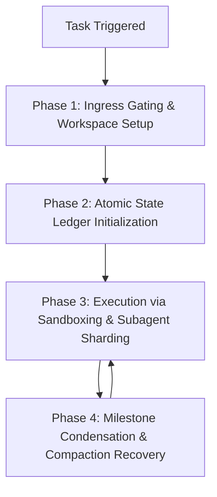

# leanctx: Universal Context Optimization & Anti-Drift Engine

`leanctx` prevents context window bloat, eliminates goal drift, and caps token accumulation across long-running coding sessions in any agent harness (Google Antigravity, Claude Code, OpenCode, Pi, Codex).

---

## 1. Trigger Conditions & Guardrails

### When to Activate
The agent MUST activate `leanctx` when:
1. The user explicitly requests context optimization, cost reduction, or session memory management.
2. Embarking on a multi-phase, large-scale implementation (e.g. major refactoring, cross-package migration, complex multi-file debugging).
3. Executing high-volume tool workflows (extensive test suites, package compilation, recursive codebase searches).

### Negative Scope: When NOT to Use
The agent MUST NOT activate `leanctx` for:
- Single-turn queries, simple 1-line edits, or quick factual code questions.
- Inspecting small files ($\le 100$ lines) or running low-output commands (`git status`, `ls`, `mkdir`).
- Trivial scripts where initializing ledgers and wrappers introduces more token overhead than it saves.

### Progressive Disclosure Directive
Skip reference files during normal execution. Read `[references/context-taxonomy.md](./references/context-taxonomy.md)` only when auditing retention tiers. Read `[references/harness-matrix.md](./references/harness-matrix.md)` only when configuring platform-specific hooks or CLI aliases.

---

## 2. Dynamic Script Path Resolution

Before invoking any bundled utilities, the agent MUST resolve the `leanctx` script directory:
1. Local Workspace: `.agents/skills/leanctx/scripts` or `skills/leanctx/scripts`
2. Global Directory: `~/.claude/skills/leanctx/scripts`, `~/.gemini/config/skills/leanctx/scripts`, `~/.codex/skills/leanctx/scripts`, `~/.opencode/skills/leanctx/scripts`, or `~/.pi/skills/leanctx/scripts`
3. Environment Variable: `$LEANCTX_DIR`

Define `<SCRIPTS>` as the resolved directory path. On Windows environments without `python3`, use `python`.

---

## 3. The 6-Tier Retention & Ingress Hierarchy

```
┌────────────────────────────────────────────────────────┐
│ Rank 1: Root Intent & Invariant Rules   (DISK LEDGER)  │
│ Rank 2: Active Task & Blocker State    (DISK LEDGER)  │
│ Rank 3: Semantic Ledger & Contracts    (DISK LEDGER)  │
├────────────────────────────────────────────────────────┤
│ Rank 4: Conversational Working Memory  (HARNESS BUFFER)│
│ Rank 5: Exploratory File Reads         (INGRESS CLAMP) │
│ Rank 6: Disposable Build / Test Noise  (INGRESS SANDBOX)
└────────────────────────────────────────────────────────┘
```

- **Ranks 1–3**: Maintained persistently on disk in `.agents/memory/LEDGER.json`. Restored instantly via `ledger_tool.py rehydrate` post-compaction.
  - Rank 1: Root goal and non-negotiable negative constraints ($\le 500$ tokens). Amended ONLY via explicit user authorization.
  - Rank 2: Active DAG milestone and active blocker state ($\le 500$ tokens).
  - Rank 3: Verified technical decisions, modified files with exact public symbols, and rejected dead-end paths ($\le 1,500$ tokens).
- **Rank 4**: Conversational working buffer managed by host harness windowing ($\le 4,000$ tokens).
- **Ranks 5–6**: Gated at ingress. Raw stdout and line dumps write to disk; only concise summaries or root-cause error lines enter context history.

---

## 4. 4-Phase Operational Execution



### Phase 1: Ingress Gating & Workspace Setup
1. Verify scratch directory permissions (`0700` mode), FIFO log rotation, and `.gitignore` hygiene:
   ```bash
   python3 "<SCRIPTS>/session_init.py"
   ```
2. In harnesses with hook support (Antigravity), verify `skills/leanctx/hooks.json` is active.

### Phase 2: Atomic State Ledger Initialization
1. Initialize project objective and non-negotiable negative constraints:
   ```bash
   python3 "<SCRIPTS>/ledger_tool.py" init \
     --goal "<Primary User Acceptance Goal>" \
     --constraints "<Constraint 1>; <Constraint 2>"
   ```
2. Register active DAG milestone:
   ```bash
   python3 "<SCRIPTS>/ledger_tool.py" set-task \
     --id "<Task ID>" \
     --desc "<Task Objective>"
   ```
3. If the user explicitly amends the project goal or constraints mid-session, log the authorized amendment:
   ```bash
   python3 "<SCRIPTS>/ledger_tool.py" amend-intent \
     --goal "<Updated Goal>" \
     --constraints "<Amended Constraints>" \
     --reason "<User instruction rationale>"
   ```

### Phase 3: Execution via Output Sandboxing & Subagent Sharding
1. **High-Volume Command Execution**:
   - In Antigravity: `gate_tool.py` automatically wraps commands matching high-volume build/test executables.
   - In Claude Code / OpenCode / Pi / Codex: Execute build/test commands via `lean_run.py`:
     ```bash
     python3 "<SCRIPTS>/lean_run.py" "<test_or_build_command>"
     ```
   - On success: Emits tail 25 lines if total lines $> 30$.
   - On failure: Emits Head 15 lines, root-cause error lines from the middle of the log, and Tail 15 lines if total lines $> 50$ (maximum 65 lines).
2. **Drilling Down into Full Logs on Command Failure**:
   - If the summary misses root-cause stack traces, inspect the full log saved in `<SCRATCH>/last_exec.log` (located at `<tempdir>/leanctx-<uid>/<id>/last_exec.log`):
     ```bash
     grep -n -C 5 -i -E "error|fail|panic|exception" "<SCRATCH>/last_exec.log"
     python3 "<SCRIPTS>/lean_read.py" "<SCRATCH>/last_exec.log" --start <line> --end <line+50>
     ```
3. **File Reading Line Clamping**:
   - Never ingest entire multi-hundred line files without line bounds.
   - Use targeted line ranges or invoke `lean_read.py`:
     ```bash
     python3 "<SCRIPTS>/lean_read.py" path/to/large_file.py --start 1 --end 150
     ```
4. **Subagent Context Sharding**:
   - For broad codebase scans or multi-step debugging, launch an isolated subagent (`invoke_subagent` in Antigravity, Task agent in Claude Code, child agent in OpenCode).
   - In single-agent harnesses without subagents: run discovery via targeted single-line CLI commands piping to `grep` or temporary files. Do not dump directory trees into conversation turns.

### Phase 4: State Condensation & Compaction Recovery
1. After completing an execution milestone, update modified files and decisions in the ledger:
   ```bash
   python3 "<SCRIPTS>/ledger_tool.py" add-file --file "<path>" --status "verified" --symbols "<exported signatures>"
   python3 "<SCRIPTS>/ledger_tool.py" add-decision --text "<Verified decision>"
   ```
2. When hitting a dead end or rejecting a failed path, record the negative knowledge to eliminate repeat attempts:
   ```bash
   python3 "<SCRIPTS>/ledger_tool.py" add-rejection \
     --approach "<Attempted Approach>" \
     --reason "<Why it failed or was rejected>"
   ```
3. Emit the single-line micro-anchor ($\le 60$ tokens) in active context:
   ```bash
   python3 "<SCRIPTS>/ledger_tool.py" anchor
   ```
   *Format:* `[leanctx-anchor] GOAL: <Goal> | CONSTRAINTS: <Constraints> | ACTIVE: <Task ID> (<Task Desc>) | STATE: LEDGER.json`
4. **Post-Compaction Recovery Protocol**:
   - When the host harness triggers context compaction or when resuming an existing session:
     ```bash
     python3 "<SCRIPTS>/ledger_tool.py" rehydrate
     ```
   - Restores root intent, non-negotiable negative constraints, active task, verified decisions, dead ends, and touched file signatures without asking the user to repeat requirements.

---

## 5. Verifiable Performance Targets

- **Tool Ingress Reduction**: $\ge 80\%$ reduction in tool output tokens entering conversation history.
- **Dynamic Context Growth Rate**: Session context growth bounded to $\le 5,000$ tokens per 10 execution turns (excluding base harness system prompt).
- **Compaction Recovery Invariance**: 100% retention of Rank 1 constraints and active task state post-compaction.
- **Root-Cause Error Capture**: 100% capture of compiler panics and syntax errors via smart log extraction.
