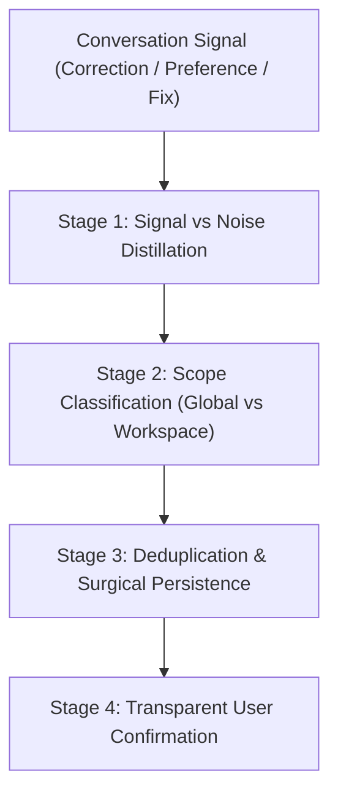

# Autonomous Instruction Learning & Distillation

The **Learn** skill extracts enduring rules, user preferences, and operational breakthroughs from conversations and persists them into agent instructions (`GEMINI.md` / `AGENTS.md`) so they are remembered in all future turns and sessions.

---

## 1. Trigger Conditions

The agent **MUST** activate this skill when:
1. **User Correction**: The user corrects agent behavior (*"Don't do X, always do Y"*, *"In this project we use Z"*).
2. **Preference Expression**: The user expresses a stylistic, architectural, or workflow habit (*"I prefer functional style"*, *"Never commit without running lint"*).
3. **Complex Resolution**: The agent and user successfully resolve an esoteric build error, flaky test suite, or tricky environment quirk after trial and error.
4. **Explicit Command**: The user types `/learn`, *"remember this"*, or *"add this to your rules"*.

---

## 2. 4-Stage Learning Workflow



### Stage 1: Distill Signal from Noise
- Discard transient chatter, one-off file edits, or session-specific variables.
- Extract the underlying, generalizable invariant.
- Formulate the rule using imperative keywords: **`ALWAYS`**, **`NEVER`**, **`MUST`**.
- Formulate a 1-sentence rationale explaining the failure mode it prevents.

### Stage 2: Scope Classification
Determine the storage target ([see references/instruction-taxonomies.md](references/instruction-taxonomies.md)):
- **Global Scope** (`~/.gemini/GEMINI.md`): Universal across all projects (e.g., coding idioms, formatting, general agent behavior).
- **Workspace Scope** (`<workspace>/GEMINI.md` or `AGENTS.md`): Specific to this repository (e.g., package manager, test flags, build pipelines, directory structure).
- **Skill Scope** (`skills/<name>/SKILL.md`): Multi-step procedural runbooks ($>5$ steps).

### Stage 3: Deduplication & Surgical Persistence
Use the instruction updater script to prevent duplicates, avoid contradictory rules, and respect the 24KB limit:

```bash
python3 ~/.gemini/config/skills/learn/scripts/instruction_updater.py \
  --file <path_to_GEMINI.md> \
  --category "<Category Name>" \
  --rule "<IMPERATIVE DIRECTIVE>" \
  --rationale "<One-sentence justification>"
```

### Stage 4: Transparent User Confirmation
Inform the user clearly:
> *"I have updated persistent instructions in `<path>`:*  
> *• **[Category]**: `<Directive>`"*

---

## 3. Mandatory Guardrails & Directives

1. **Imperative & Token-Optimized Authoring**: All generated skills, rules, or instructions **MUST** use strictly imperative language (`ALWAYS`, `NEVER`, `MUST`) and **MUST** be aggressively token-optimized (high density, progressive disclosure, no cosmetic fluff).
2. **NO Transient Data**: Never record passwords, API keys, temporary tokens, or user-specific mock data.
3. **NO Contradictions**: If the new rule conflicts with an existing rule, update the existing rule rather than appending a contradiction.
4. **Size Budget Compliance**: Rule files **MUST NOT** exceed 24,000 bytes. When approaching 20KB, prune obsolete rules.
5. **Non-Intrusive Execution**: When learning implicitly from user corrections, execute the update cleanly and confirm briefly without derailing the user's primary task.
