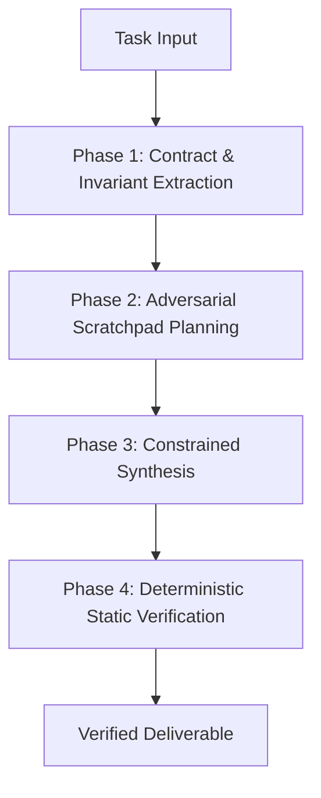

# Single-Pass Zero-Defect Execution Protocol

The **Single-Pass Executor** enforces zero-shot accuracy and prevents iterative debugging loops by frontloading contract extraction, adversarial scratchpad planning, and static verification gates.

---

## 1. Trigger Conditions

The agent MUST activate this skill when:
1. The user requests mission-critical code generation, complex refactors, or schema modifications without trial-and-error iterations.
2. The user demands first-pass accuracy or zero-defect execution.
3. Complex algorithmic logic requires handling multiple strict boundary conditions.

---

## 2. 4-Phase Execution Workflow



### Phase 1: Contract & Invariant Extraction
Before emitting any production code or payload:
- MUST extract all parameter types, bounds, return signatures, and expected exceptions.
- MUST identify non-functional constraints (concurrency, idempotency, time/space complexity).
- Reference playbook: [single-pass-playbook.md](./references/single-pass-playbook.md).

### Phase 2: Adversarial Scratchpad Planning
The agent MUST formulate an explicit scratchpad containing:
1. **Boundary Conditions**: Explicit checks for $N=0$, $N=1$, `None`/`null`, and collection overflow.
2. **Top Failure Vectors**: Identify 3 concrete conditions that would cause runtime crashes.
3. **Defense Strategy**: Specify code countermeasures before writing logic.
- Reference exemplar: [exemplar-scratchpad.md](./examples/exemplar-scratchpad.md).

### Phase 3: Constrained Synthesis
During final artifact generation:
- MUST implement all defenses identified in the scratchpad.
- MUST preserve all existing docstrings, typing contracts, and architectural interfaces.
- NEVER rely on unhandled default cases; explicit error raising is MANDATORY.

### Phase 4: Deterministic Static Verification
Execute the verification utility on generated artifacts prior to declaring completion:

```bash
python3 ~/.gemini/config/skills/single-pass-executor/scripts/verify_contracts.py "<target-file>"
```

Verification assertions:
- Python files MUST parse cleanly via Python AST without syntax errors.
- JSON artifacts MUST parse valid schema structures.
- Shell scripts MUST pass `bash -n` syntax check.
- If verification fails, the agent MUST remediate errors before presenting output.
