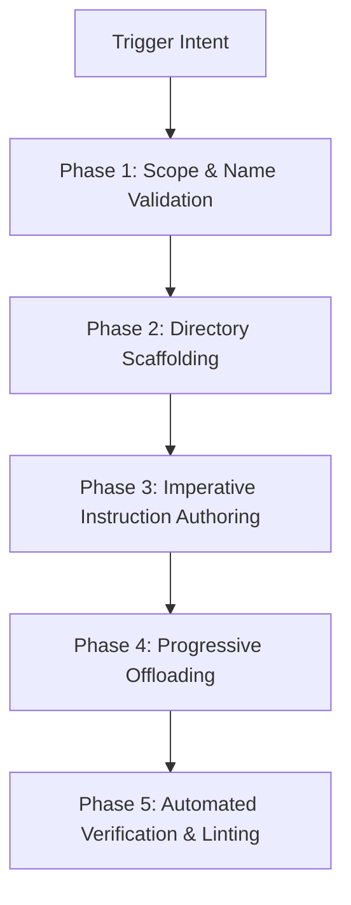

# Skill Creator Workflow

The **Skill Creator** standardizes the creation, scaffolding, and verification of agent skills across global and workspace scopes.

---

## 1. Trigger Conditions

The agent MUST activate this skill when:
1. The user requests creating, generating, or scaffolding an agent skill or procedural workflow.
2. The user runs `/skill` or asks how to automate a repeated multi-step runbook for agents.
3. Complex multi-step operations require packaging into persistent on-demand procedures.

---

## 2. 5-Phase Execution Protocol



### Phase 1: Scope & Name Determination
1. **Scope Selection**:
   - MUST set scope to **Global** (`~/.gemini/config/skills/`) for cross-project tools, idioms, and meta-workflows.
   - MUST set scope to **Workspace** (`.agents/skills/`) for project-specific deployment, build, and test runbooks.
   - Workspace paths automatically anchor to the repository root via `.git` or `.agents`.
2. **Identifier Validation**:
   - Skill name MUST be strictly lowercase kebab-case (`^[a-z0-9]+(-[a-z0-9]+)*$`).
   - Format MUST follow `action-target` (e.g., `build-firmware`) or `domain-action` (e.g., `db-migrate`).

### Phase 2: Directory Scaffolding
Execute the scaffolding utility to instantiate the required layout:

```bash
python3 ~/.gemini/config/skills/skill-creator/scripts/scaffold_skill.py scaffold \
  --name "<skill-name>" \
  --description "<Concise 3rd-person trigger condition under 80 words>" \
  --scope "<global|workspace>"
```

Scaffolding automatically provisions:
- `SKILL.md` (Main instruction entry point)
- `scripts/` (Executable helpers)
- `references/` (Large specs and background contracts)
- `examples/` (Input/output reference patterns)

### Phase 3: Imperative Instruction Authoring
When authoring `SKILL.md`:
- Directives MUST strictly use imperative keywords: **`ALWAYS`**, **`NEVER`**, **`MUST`**.
- Directives MUST NOT contain non-imperative modal auxiliaries (banned hedge phrases: should, could, might, try to, please).
- Every action step MUST specify an exact failure condition and deterministic recovery behavior.
- Reference standards: [schema-and-standards.md](./references/schema-and-standards.md).

### Phase 4: Progressive Disclosure Offloading
- Line Budget: `SKILL.md` MUST remain under 200 lines.
- Offload lengthy API schemas, JSON examples, or command catalogs into `references/`.
- Offload multi-command shell logic into executable scripts in `scripts/`.
- Reference template: [minimal-skill.md](./examples/minimal-skill.md).

### Phase 5: Automated Verification & Linting
Run the validation script against the created skill before finalizing:

```bash
python3 ~/.gemini/config/skills/skill-creator/scripts/scaffold_skill.py validate \
  "<path-to-skill-directory>"
```

Verification assertions:
- MUST confirm zero schema errors in frontmatter.
- MUST confirm absence of non-imperative language.
- MUST confirm scripts in `scripts/` have execution permissions.
- MUST confirm exit code is 0. If validation fails, errors MUST be corrected immediately.

---

## 3. Skill Inventory

List all discovered skills across workspace and global configurations:

```bash
python3 ~/.gemini/config/skills/skill-creator/scripts/scaffold_skill.py list --scope all
```
