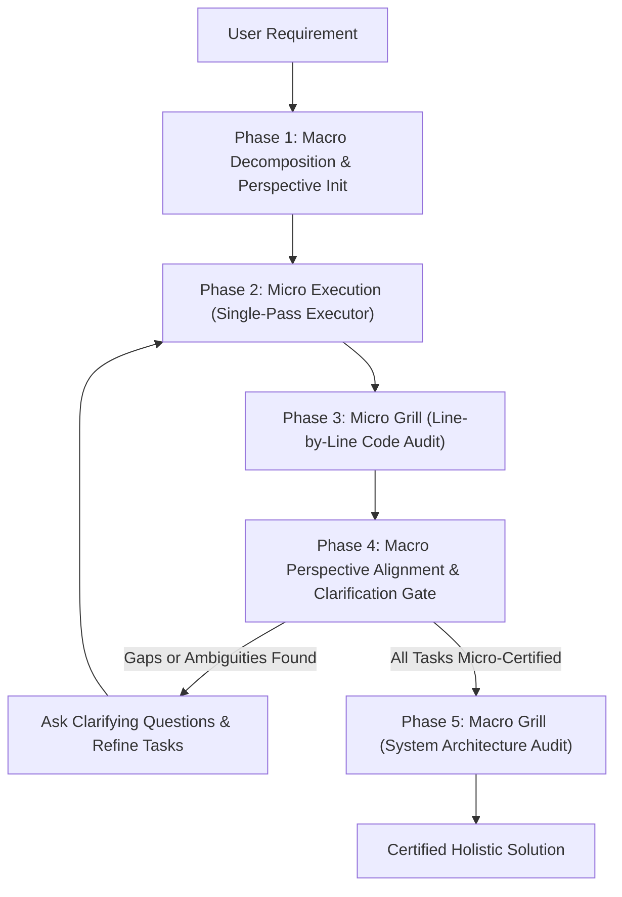

# Telescope Orchestrator: Dual-Lens Execution Protocol

The **Telescope** skill bridges high-level architectural requirements with low-level implementation details through continuous zoom-in execution, dual-layer grill audits, and macro perspective alignment.

---

## 1. Trigger Conditions

The agent MUST activate this skill when:
1. The user provides complex, multi-phase requirements that require decomposition into discrete sub-tasks.
2. The user demands end-to-end verification across both high-level system architecture and low-level code.
3. Multi-task implementations risk architectural drift, missing contracts, or unresolved ambiguities.

---

## 2. 5-Phase Dual-Lens Execution Loop



### Phase 1: Macro Decomposition & Perspective Initialization (Zoom-Out)
1. Initialize the living perspective tracker:
   ```bash
   python3 ~/.gemini/config/skills/telescope/scripts/orchestrate_dag.py init \
     --project "<Project Name>" \
     --objective "<High-Level Requirements>"
   ```
2. Decompose high-level requirements into a Directed Acyclic Graph (DAG) of low-level tasks:
   ```bash
   python3 ~/.gemini/config/skills/telescope/scripts/orchestrate_dag.py add-task \
     --id "<task-id>" \
     --title "<Task Title>" \
     --spec "<Input/Output Interface Contract>" \
     --depends-on "<parent-task-ids>"
   ```
3. Reference standards: [zoom-framework.md](./references/zoom-framework.md).

### Phase 2: Micro Task Execution (Zoom-In)
For each ready task in the DAG:
1. Extract strict input/output contracts, error states, and boundary conditions.
2. Formulate an in-context scratchpad analyzing top runtime failure modes.
3. Synthesize the implementation deterministically using **`single-pass-executor`**.
4. Run static contract verification via `verify_contracts.py`.

### Phase 3: Micro Grill Review (Zoom-In)
1. Subject the task's code to line-by-line scrutiny using targeted **`grill`** personas:
   - **Developer**: Resource cleanup, defensive typing, absence of bare exception catches.
   - **QA / Tester**: Boundary conditions ($N=0, 1, \infty, \text{None}$).
   - **Security**: Parameterized arguments, injection prevention, input sanitization.
2. Loop review and fixes until zero defects remain.
3. Mark task as micro-grilled:
   ```bash
   python3 ~/.gemini/config/skills/telescope/scripts/orchestrate_dag.py update-task \
     --id "<task-id>" --status "MICRO_GRILLED"
   ```

### Phase 4: Macro Perspective Alignment & Clarification Gate (Zoom-Out)
Step back to inspect the whole system:
1. Render and review the living perspective report:
   ```bash
   python3 ~/.gemini/config/skills/telescope/scripts/orchestrate_dag.py render
   ```
2. **Holistic Sanity Check**:
   - Evaluate whether what has been implemented fulfills the high-level intent.
   - Verify interfaces between task $K$ and downstream tasks align seamlessly.
3. **Clarification Protocol**:
   - If requirements diverge or unstated assumptions emerge, the agent MUST halt execution immediately.
   - The agent MUST ask targeted clarifying questions before writing further code.
   - Record resolved answers via `orchestrate_dag.py clarify`.

### Phase 5: Macro Grill Review (Zoom-Out)
Once all low-level tasks achieve micro-certification:
1. Subject the aggregated codebase and perspective document to macro **`grill`** personas:
   - **Architect**: Topological DAG integrity, absence of circular dependencies, contract versioning.
   - **SRE & Reliability**: Network timeouts, graceful shutdown, failure domain isolation.
   - **Performance & Cost**: Algorithmic complexity, memory bounds, token economy.
   - **Designer / DX**: API ergonomics, predictable exit codes, actionable error feedback.
   - **Compliance**: Zero PII, license compatibility, security audit trails.
2. Certify holistic zero-defect delivery.
