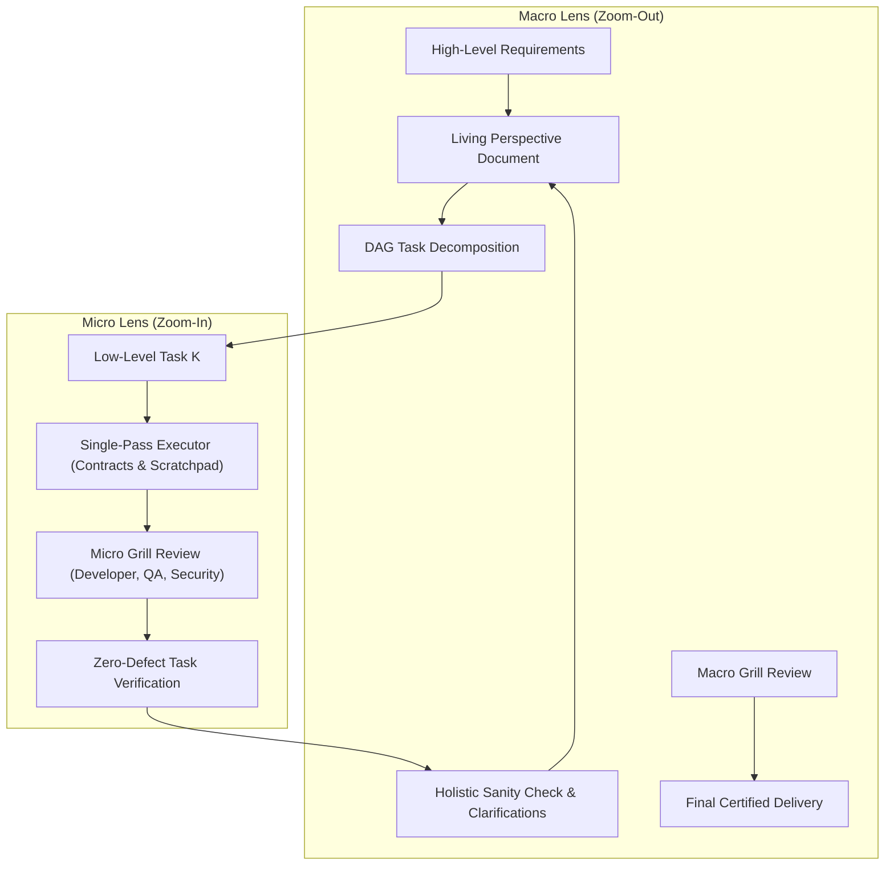

# The Dual-Lens Telescope Framework

## 1. Dual-Lens Architecture

---

## 2. Micro Lens Invariants (Zoom-In)

When executing an individual sub-task:
1. **Contract Locking**: The agent MUST define parameter types, return structures, and exception types before implementation.
2. **Scratchpad Formulation**: The agent MUST enumerate three concrete runtime failure modes and defenses.
3. **Micro Grill Personas**: Scrutiny MUST invoke:
   - **Developer**: Resource cleanup, defensive typing, absence of bare exception catches.
   - **QA / Tester**: Boundary conditions ($N=0, 1, \infty, \text{None}$).
   - **Security**: Parameterized arguments, absence of command/SQL injection, input sanitization.
4. **Local Convergence**: The agent MUST NEVER advance to task $K+1$ until task $K$ achieves zero defects under micro review.

---

## 3. Macro Lens Invariants (Zoom-Out)

When stepping back to assess the overall solution:
1. **Perspective Document Maintenance**: The agent MUST maintain a living `PERSPECTIVE.md` reflecting overall completion, registered architectural decisions, and task dependencies.
2. **Holistic Sanity Interrogation**:
   - Does what has been implemented satisfy the root requirement?
   - Do contracts between task $K$ and task $K+1$ align seamlessly?
   - Has new implementation revealed contradictions in subsequent tasks?
3. **Clarification Protocol**:
   - If requirements diverge or unstated assumptions emerge, the agent MUST halt execution immediately.
   - The agent MUST formulate targeted multiple-choice or direct questions for the user.
   - NEVER proceed on speculative architectural guesses without confirmation.
4. **Macro Grill Personas**: Final system validation MUST invoke:
   - **Architect**: Topological DAG integrity, absence of circular dependencies, contract versioning.
   - **SRE & Reliability**: Network timeouts, graceful shutdown, failure domain isolation.
   - **Performance & Cost**: Algorithmic complexity, memory bounds, token economy.
   - **Designer / DX**: API ergonomics, predictable exit codes, actionable error feedback.
   - **Compliance**: Zero PII, license compatibility, security audit trails.
